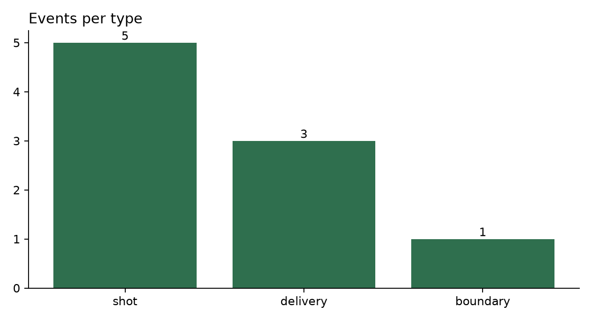

# Cricket Event Annotation Pipeline

A small, end-to-end pipeline for turning cricket video clips into a **trustworthy dataset** that a CV/AI engineer can use:
provenance tracking → versioned event schema → keyboard-driven annotation tool → automated QA → inter-annotator agreement → ML-assisted segmentation check → dataset card.

## What's in here

| Path | Purpose |
|---|---|
| `schema/event_schema.json` | JSON Schema (v1.0.0) for annotations: delivery, shot, boundary, wicket, appeal, extra, fielding |
| `docs/ANNOTATION_GUIDELINES.md` | Exact definitions + edge cases so two people label the same way |
| `docs/WHERE_TO_FIND_VIDEOS.md` | Legal sources of cricket footage and how to log them |
| `tools/annotator.html` | Offline, no-install annotation tool (hotkeys, timeline, JSON export) |
| `scripts/register_clip.py` | Hash + probe a clip, append a row to `data/provenance.csv`, reject duplicates |
| `scripts/validate.py` | Schema + logic + coverage + provenance QA → `reports/qa_report.md` |
| `scripts/agreement.py` | Event F1, attribute Cohen's kappa, time-bin kappa between two annotators |
| `scripts/auto_segment.py` | PySceneDetect proposals vs your manual delivery boundaries |
| `scripts/stats.py` | Charts + `DATASET_CARD.md` |
| `examples/` | A tiny example annotation file showing the format |

## Setup

```bash
python -m venv .venv && source .venv/bin/activate     # Windows: .venv\Scripts\activate
pip install -r requirements.txt
```

## Workflow

```bash
# 1. Put a clip in data/clips/ (lowercase_with_underscores.mp4), then register it with its source + licence
python scripts/register_clip.py data/clips/nets_session_01.mp4 \
    --platform self_recorded --licence "Own work" --author "Your Name"

python scripts/register_clip.py data/clips/pexels_batsman_03.mp4 \
    --platform Pexels --url "https://www.pexels.com/video/..." \
    --licence "Pexels License" --licence-url "https://www.pexels.com/license/" --author "Photographer"

# 2. Annotate: open tools/annotator.html in Chrome/Edge, load the video, label events, press Ctrl+S.
#    Move the downloaded JSON to data/annotations/main/<clip_id>.json

# 3. QA (run after every session; fix everything it reports)
python scripts/validate.py

# 4. Ask a friend to annotate 5+ clips independently (id "friend" in the tool) -> data/annotations/friend/
python scripts/agreement.py --a main --b friend --tol 1.0 --bin 0.5

# 5. ML-assisted check
python scripts/auto_segment.py --annotator main

# 6. Charts + dataset card
python scripts/stats.py --annotator main
```

## Annotation tool hotkeys

`Space` play/pause · `←/→` ±1 s (`Shift` ±5 s) · `,` `.` single frame · `[` set start · `]` set end ·
`1–7` choose event type · `Enter` add/update · `Delete` remove selected · `Ctrl+S` export.
Click a row to edit it; the timeline shows every event (wickets red, boundaries amber). Progress autosaves in the browser.

## Design decisions (worth saying in an interview)

* **Provenance first.** Every clip has source, licence, collection date and SHA-256; duplicates are rejected and file changes are detected. Raw videos are not committed, only provenance + annotations.
* **Schema-enforced labels.** Conditional fields (a `wicket` must have a `dismissal`, a `boundary` must have `runs` of 4 or 6) are enforced by JSON Schema, not by convention.
* **Cross-event consistency checks.** A delivery whose outcome is `wicket` must contain a wicket event; events can't overlap or run past the clip.
* **Agreement before scale.** If kappa for a class is low, the guideline is ambiguous: fix the guideline, bump the schema/guideline version, re-annotate.
* **Automation is a helper, not the truth.** Scene detection proposes boundaries; the report shows where it fails (replays, single-camera nets footage).

## Scaling to 1,000 clips (the process in short)

1. **Collect** with a manifest per source batch (URL, licence, hash); dedupe by hash and perceptual hash; reject unlicensed footage.
2. **Structure** with a fixed folder layout, a stable `clip_id`, one versioned schema, and a pinned guideline document.
3. **Annotate** in rounds: a pilot of ~50 clips by 2+ annotators to refine the guideline; then production with a 10–15% double-annotated sample; pre-fill boundaries from scene detection to speed things up.
4. **QA** automatically on every commit (`validate.py`) plus targeted human review of low-confidence labels and the lowest-kappa classes.
5. **Release** with a dataset card (counts, class balance, limitations, licences), fixed train/val/test splits **by match/source** (never by clip, to avoid leakage), and a changelog.

## Results (fill in from your own run)

| Metric | Value |
|---|---|
| Clips / total duration | 5 clips/ 39s total |
| Events annotated | 9 |
| Event-detection F1 vs second annotator | Not measured (single annotator) |
| Time-bin Cohen's kappa | Not measured (single annotator) |
| Delivery boundaries matched by auto cuts |0/6 (clips are single-shot, so scene detection finds no cuts) |



## Known limitations

1. Small sample (5 clips, about 40 seconds), mostly stock footage.
2. Single annotator, so inter-annotator agreement has not been measured. The agreement tooling (scripts/agreement.py) is included and tested for use with a second annotator.
3. Most clips are single continuous shots, so automatic scene detection finds no delivery boundaries.
4. No wickets in the current data, so dismissal types are untested.
